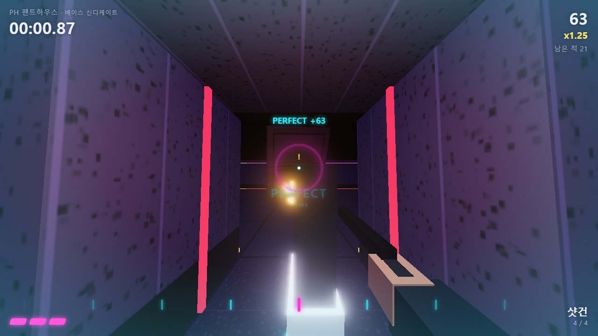
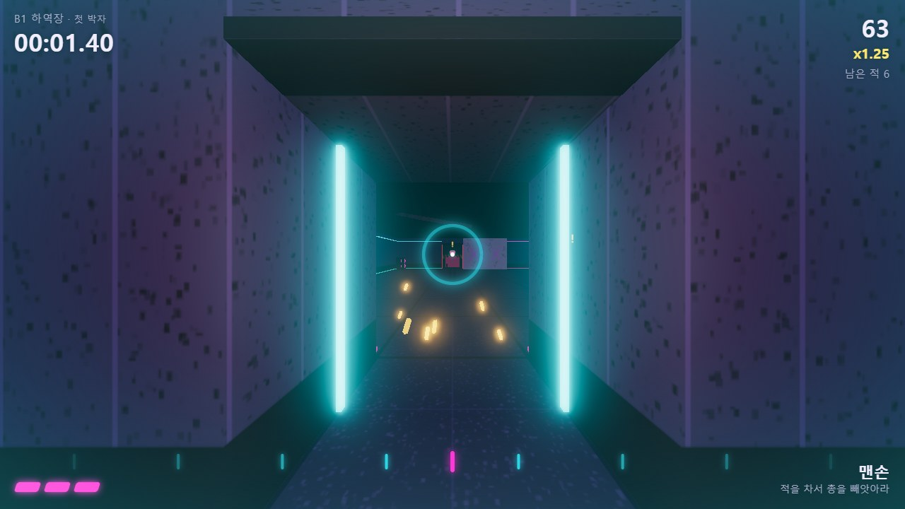
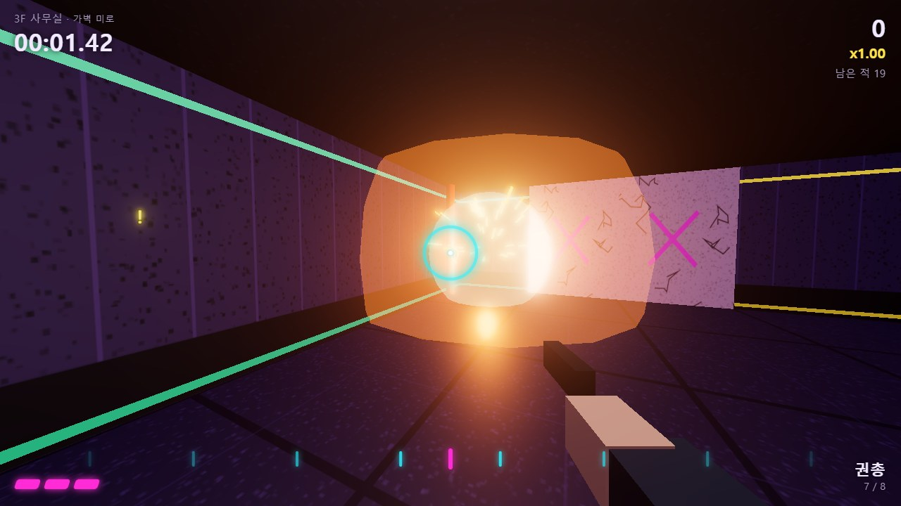
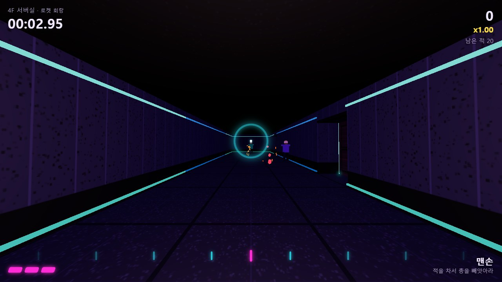
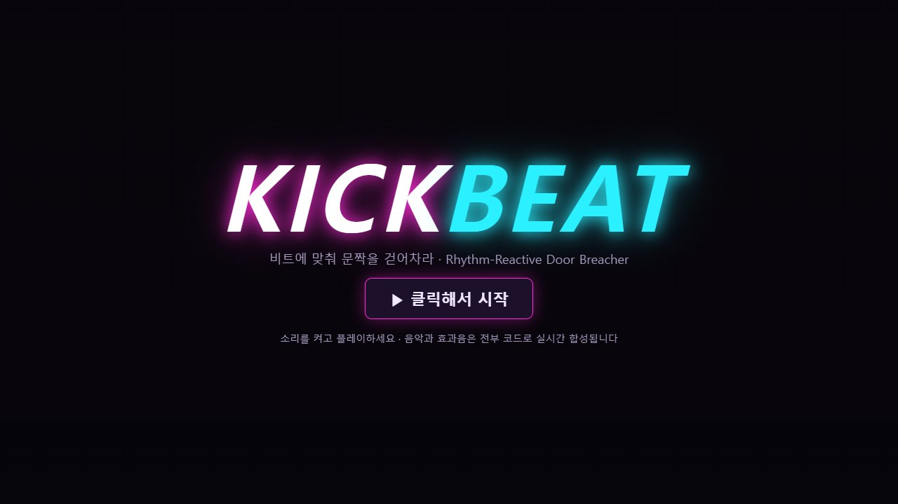

<div align="center">



# 킥비트 · KickBeat

**비트에 맞춰 문짝을 걷어차는 브라우저 리듬 1인칭 액션**

PERFECT 비트 불릿타임 · 발차기 패링 · 석고벽 돌파 · 가스 폭발 연쇄 · 고스트 타임어택 · 내 음악으로 만드는 스테이지

<p>
  <a href="https://jeiel85.github.io/kick-beat/"></a>
</p>
<p>
  
  
  
  
  
  
  <a href="https://github.com/jeiel85/kick-beat/actions/workflows/pages.yml"></a>
</p>

</div>

---

## 어떤 게임인가요

베이스 신디케이트가 도시의 모든 스피커를 장악했습니다. 지하 하역장에서 펜트하우스까지, **쿵쾅거리는 하드베이스 박자에 맞춰 문을 걷어차며** 올라가세요.

화면 가운데 링이 닫히는 순간(박)에 발차기를 넣으면 **PERFECT** — 문짝이 두 배 힘으로 날아가 뒤에 선 적들을 볼링 핀처럼 쓰러뜨리고, 세상이 느려지는 **불릿타임**이 걸립니다. 적의 총알은 즉발 히트스캔이 아니라 **눈에 보이는 탄**이라, 박자에 맞춰 발로 차서 **되돌려 보낼(패링)** 수 있습니다. 잠긴 문은 옆의 석고보드 벽째로 뚫고, 가스관을 차서 새게 한 뒤 총격 불꽃 한 번으로 방 전체를 날려 버리세요.

죽어도 로딩은 없습니다. **R 한 번이면 6ms 안에 재시작**되고 음악은 끊기지 않습니다.

## 갤러리

| | |
|---|---|
|  |  |
|  |  |

## 특징

- **비트 싱크 발차기** — 판정은 렌더 프레임이 아니라 **오디오 클록**(`AudioContext.getOutputTimestamp`) 기준입니다. 입력 이벤트의 타임스탬프를 스피커에서 실제로 들리는 시각으로 바꿔 ±50ms PERFECT / ±110ms GOOD을 가립니다. 블루투스 이어폰처럼 지연이 큰 환경을 위한 **탭 테스트 자동 보정**도 있습니다.
- **PERFECT 불릿타임** — 세계는 0.3배속으로 느려지고 플레이어는 덜 느려집니다(상대적으로 빨라짐). 음악에는 저역 통과 필터가 걸리지만 킥 드럼은 그대로 들려 다음 박을 계속 탈 수 있습니다.
- **발차기 패링** — 앞쪽 원뿔 안의 적 탄·로켓을 되돌려 보냅니다. 시선 25° 안에 적이 있으면 그쪽으로 보정됩니다. 적은 쏘기 전에 총구가 빨갛게 부풀어 오르는 **예고 동작**이 있어 억울한 즉사가 없습니다.
- **문짝 볼링** — 걷어찬 문짝은 cannon-es 강체로 날아가며 경로의 적을 래그돌로 만들고, 날아간 래그돌이 다시 다른 적을 칩니다. 문짝 하나로 두 명 이상 = **STRIKE**.
- **환경 파괴 연쇄** — 석고보드 벽 돌파(파편과 함께 벽 너머 적까지), 가스관 누출 → 총격·적의 총구 불꽃·로켓으로 유폭 → 주변 가스관·샹들리에·문·가벽까지 연쇄, 샹들리에를 쏴 떨어뜨려 압사.
- **무기 탈취** — 쓰러진 적이 떨군 총을 공중에서 낚아채면 **HIJACK** 보너스. 총알은 몇 발 없고, 다 쓰면 던져서 한 명 더.
- **5개 캠페인 스테이지** — 150 → 160 → 170 → 180 → **200 BPM**. 스테이지마다 별 3개(클리어 / 기준 시간 / 고유 과제)와 S~C 랭크.
- **스니커즈 4종** — 별을 모아 해금. 기본 하이탑, 이동 +15% BPM 러너, 잠긴 강철문도 차는 스틸토 브리처, PERFECT 판정 창이 넓은 드롭 해머.
- **고스트 타임어택** — 최고 기록의 궤적을 20Hz로 저장해 다음 판에 반투명 잔영으로 함께 달립니다. 결과 화면에서 **고스트 파일(.json)로 내보내** 친구에게 주면, 친구는 스테이지 화면에서 불러와 그 기록과 레이스할 수 있습니다.
- **내 음악으로 플레이** — MP3·WAV·FLAC·OGG를 끌어 놓으면 브라우저 안에서 킥 드럼 대역의 온셋을 뽑아 **BPM과 첫 박 위치를 분석**(자기상관 + 위상 접기)하고, 곡 길이와 구간별 에너지로 **방 개수와 적 밀도가 정해진 스테이지를 생성**합니다. 드롭 구간이 적이 몰린 방이 됩니다. 파일은 어디에도 업로드되지 않습니다.
- **랜덤 레이드** — 시드로 만드는 무한 스테이지. 같은 시드 = 같은 맵·같은 음악이라 시드만 알려 주면 기록 경쟁이 됩니다.
- **소리도 전부 코드로** — 오디오 파일이 하나도 없습니다. 찌그러진 하드베이스 킥, 오프비트 쏘우 베이스, 클랩·하이햇, 드롭 구간의 스탭 코드와 라이저까지 시드마다 다른 곡을 Web Audio로 실시간 합성합니다. 효과음(문짝 파쇄, 벽 붕괴, 패링, 폭발…)도 마찬가지입니다.
- **게임패드** — 표준 매핑 패드(Steam Deck 브라우저 포함) 지원.

## 조작법

| 입력 | 동작 |
| --- | --- |
| WASD / 방향키 | 이동 (항상 전력 질주) |
| 마우스 | 시점 |
| **F · E · 우클릭** | **발차기** — 링이 닫히는 순간이면 PERFECT |
| 좌클릭 | 사격 (빼앗은 총) |
| Q · G | 총 던지기 |
| Space | 점프 |
| **R** | **즉시 재시작** (언제든) |
| Esc | 일시정지 |
| 게임패드 | 왼스틱 이동 · 오른스틱 시점 · LB/RB/LT 발차기 · RT 사격 · A 점프 · X 던지기 · Y 재시작 · Start 일시정지 |

> 키보드+마우스 또는 게임패드가 필요합니다(터치 전용 기기는 미지원). 소리를 켜고 플레이하세요.

## 기술 구성

| 영역 | 구현 |
| --- | --- |
| 렌더링 | three.js — 인스턴싱 벽·네온 띠, 절차 캔버스 텍스처, UnrealBloom 후처리, 1인칭 뷰모델은 별도 장면으로 깊이를 지워 덧그림 |
| 이동·충돌 | 플레이어와 살아 있는 적은 **타일 격자 위 원-AABB 충돌**(즉각적이고 결정적), 시야·사격은 격자 DDA 광선 |
| 물리 | cannon-es — 날아가는 문짝·석고 파편·6부위 래그돌·샹들리에·떨어진 무기만 강체 |
| 적 AI | 플레이어 기준 BFS 거리장으로 추적, 시야·소음 감지, 공격 예고(윈드업) 후 가시 탄 발사 |
| 오디오 | Web Audio 룩어헤드 시퀀서(16분음표), 시드 기반 곡 생성, 불릿타임 저역 필터, 스테레오 패닝 효과음 |
| 비트 분석 | 160Hz 2단 저역 통과 → 10ms 에너지 → 로그 온셋 → 적응 임계 → 자기상관 후보 → 위상 접기로 0.01BPM 정밀화 |
| 저장 | `localStorage`(설정·진행·고스트). 읽은 값은 모두 검증하고, 저장 실패는 화면에 알림 |

설계 배경과 원래 기획(엔진·플랫폼·로드맵)은 [docs/design](docs/design/)의 설계서를, 웹판에서 바꾼 결정은 [DECISIONS.md](DECISIONS.md)를 보세요.

## 개발

```bash
npm install
npm run dev      # http://localhost:5173
npm test         # Vitest — 판정·비트 분석·맵 파서/생성기·점수·고스트·격자 충돌
npm run build    # dist/ (상대 경로 빌드라 어떤 정적 호스팅에서도 동작)
```

`main` 브랜치에 푸시하면 GitHub Actions가 테스트 → 빌드 → GitHub Pages 배포를 수행합니다.

### 맵 만들기

스테이지는 [src/levels/levels.js](src/levels/levels.js)의 ASCII 맵입니다. 한 칸 = 2.4m.

```
#  콘크리트 벽     =  석고보드(발로 뚫림)   D  문     L  잠긴 문
P  시작           E  출구                 G  가스관(콘크리트 벽에 붙임)   C  샹들리에
g s u r b  적(권총 / 샷건 / 기관단총 / 로켓 / 브루저)
1 2 3 4    바닥 무기(권총 / 샷건 / 기관단총 / 로켓 런처)
```

테스트가 모든 스테이지에 대해 문 방향, 가스관 위치, **출구와 모든 적·무기에 실제로 도달할 수 있는지**(잠긴 문은 막힘으로 보고 BFS)를 검사합니다. 절차 생성기도 300개 시드로 같은 검사를 통과해야 합니다.

## 프로젝트 구조

```
src/
  audio/    engine.js(신스·효과음·클록) · beatClock.js(판정) · beatDetect.js(BPM 분석)
  levels/   levels.js(캠페인 맵) · parse.js(파서·검증) · generate.js(절차 생성) · rng.js
  game/     session.js(한 판의 게임플레이) · world.js(레벨 빌드) · grid.js(충돌·광선·경로)
            humanoid.js(적 모델·래그돌) · physics.js · fx.js · viewmodel.js
            scoring.js · ghost.js · sneakers.js · assets.js
  ui/       hud.js · menus.js
  main.js   렌더러·상태 머신·저장·커스텀 음악·싱크 보정
tests/      Vitest
docs/       스크린샷 · 설계서
```

## 라이선스

[MIT](LICENSE) © jeiel85. 그래픽·음악·효과음은 모두 이 저장소의 코드가 생성합니다.
